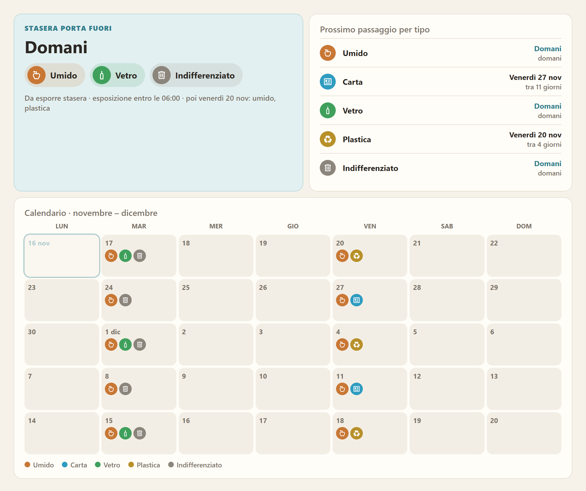
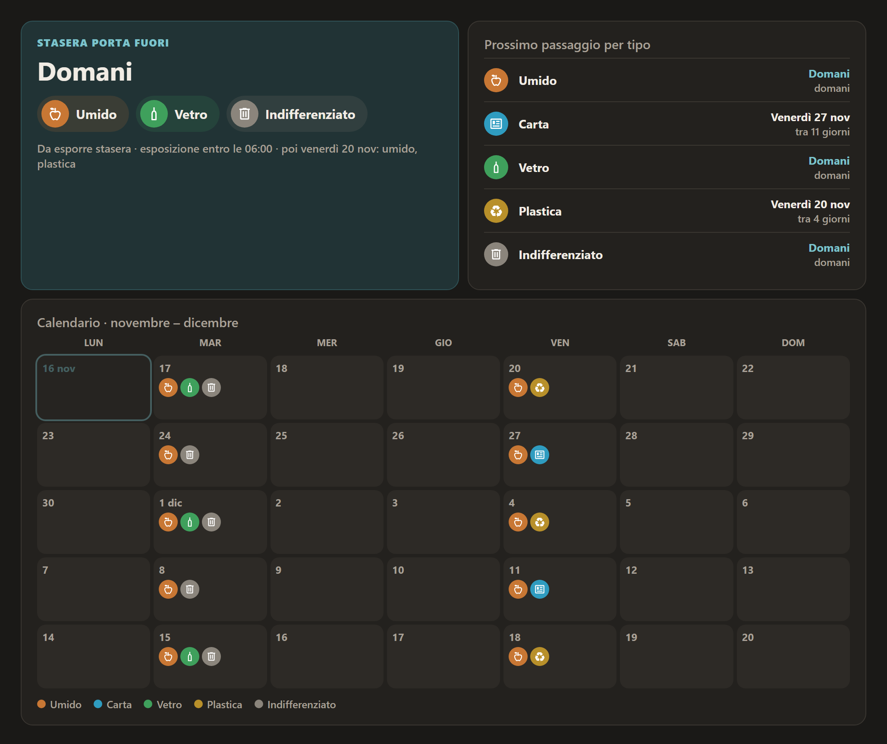

# Silea Raccolta Rifiuti

Integrazione per Home Assistant che legge il calendario della raccolta porta a porta di
[Silea](https://www.sileaspa.it/calendario-raccolta-rifiuti/) (provincia di Lecco) per la tua via.

Non è un'integrazione ufficiale di Silea: usa gli stessi dati della pagina "Calendario raccolta rifiuti" del sito.

**Uso corretto del sito Silea.** L'integrazione fa le stesse richieste della pagina del calendario, solo per la via configurata,
ogni 12 ore circa (con uno scarto diverso per ogni installazione), e si presenta con uno User-Agent che rimanda a questo repository.
Se Silea chiede di modificarla o di toglierla, verrà fatto: per segnalazioni apri una [issue](https://github.com/MCoLoL/silea-rifiuti/issues).



## Cosa crea

Per ogni via configurata:

| Entità | Cosa mostra |
|---|---|
| `calendar.…_calendario` | Un evento per ogni tipo di rifiuto ritirato, con orario e note di Silea |
| `sensor.…_prossimo_ritiro` | Data del prossimo ritiro; negli attributi i tipi, i giorni mancanti e le note |
| `sensor.…_da_esporre` | Cosa portare fuori: i ritiri di domani, o di oggi finché non sono conclusi. "Niente" se non c'è nulla |
| `sensor.…_prossimo_umido`, `_carta`, `_vetro`, `_plastica`, `_indifferenziato` | Data del prossimo passaggio di ogni tipo |

Un ritiro di oggi conta come passato dopo l'orario di fine indicato da Silea (di solito 13:30).
I dati si aggiornano ogni 12 ore. Di default vengono scaricati 4 mesi; si cambia dalle opzioni dell'integrazione.

## Scheda per la dashboard

L'integrazione include una scheda, caricata in automatico: non serve aggiungere risorse.
Mostra il prossimo ritiro (evidenziato la sera prima), il prossimo passaggio di ogni tipo e un calendario di 5 settimane.
Usa i colori del tema, quindi funziona sia con il tema chiaro sia con quello scuro.

```yaml
type: custom:silea-rifiuti-card
entity: calendar.raccolta_rifiuti_via_esempio_calendario
weeks: 5                     # facoltativo
names:                       # facoltativo: nomi personalizzati per tipo
  indifferenziato: Secco
  plastica: Plastica e lattine
```

I tipi sono `umido`, `carta`, `vetro`, `plastica`, `indifferenziato`.

<details><summary>Tema scuro</summary>



</details>

## Installazione

Da Home Assistant 2026.11 (Marketplace):

1. *Impostazioni → Marketplace → Aggiungi da link*, incolla `https://github.com/MCoLoL/silea-rifiuti` (serve aver collegato un account GitHub al Marketplace).
2. Installa **Silea Raccolta Rifiuti** e riavvia Home Assistant.
3. *Impostazioni → Dispositivi e servizi → Aggiungi integrazione → Silea Raccolta Rifiuti*, poi scegli comune e via.

Con HACS (Home Assistant 2026.10 e precedenti):

1. HACS → menu ⋮ → *Repository personalizzati* → aggiungi `https://github.com/MCoLoL/silea-rifiuti`, categoria *Integrazione*.
2. Installa **Silea Raccolta Rifiuti**, riavvia e aggiungi l'integrazione come sopra.

L'icona dell'integrazione compare da Home Assistant 2026.3.

A mano: copia `custom_components/silea_rifiuti` nella cartella `custom_components` di Home Assistant e riavvia.

## Esempio: avviso la sera prima

```yaml
triggers:
  - trigger: time
    at: "20:00:00"
conditions:
  - condition: not
    conditions:
      - condition: state
        entity_id: sensor.raccolta_rifiuti_da_esporre
        state: "Niente"
  - condition: state
    entity_id: sensor.raccolta_rifiuti_da_esporre
    attribute: quando
    state: domani
actions:
  - action: notify.notify
    data:
      title: Stasera porta fuori
      message: "{{ states('sensor.raccolta_rifiuti_da_esporre') }}"
```

## Licenza

MIT. Vedi [LICENSE](LICENSE).
